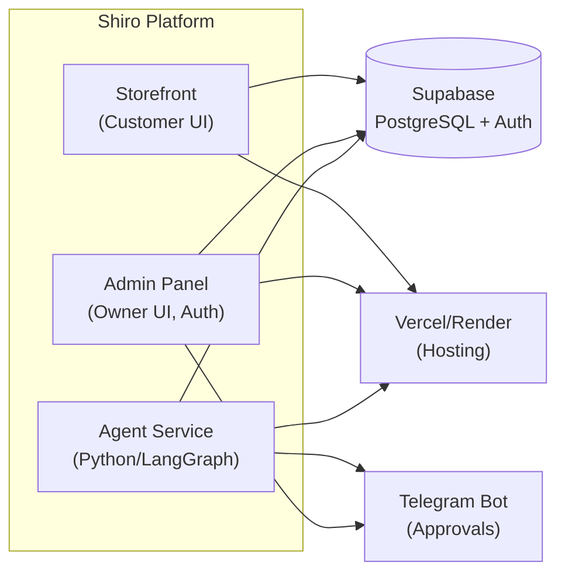
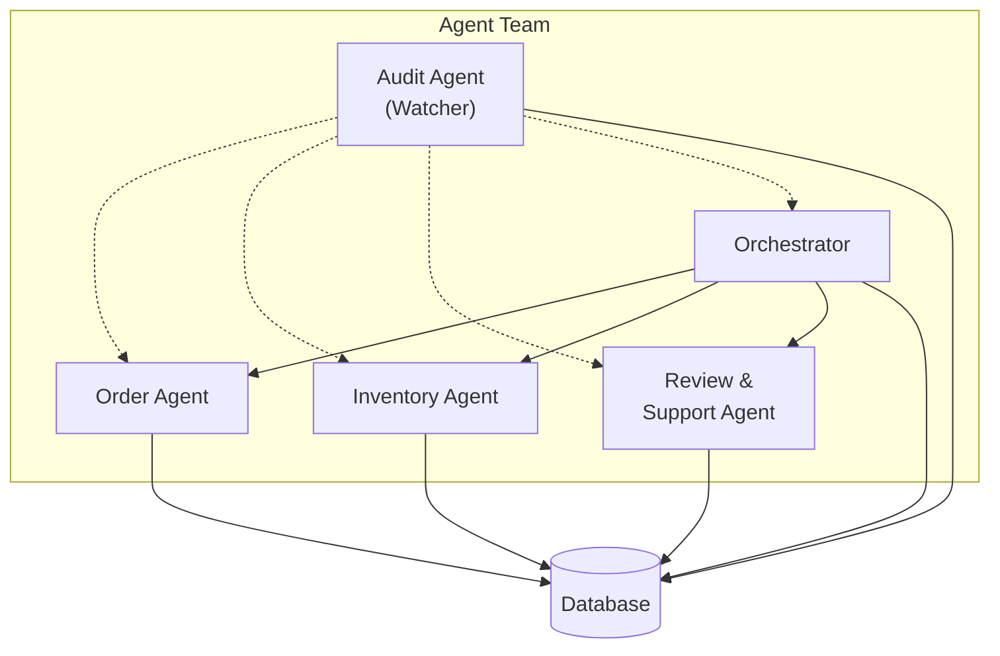
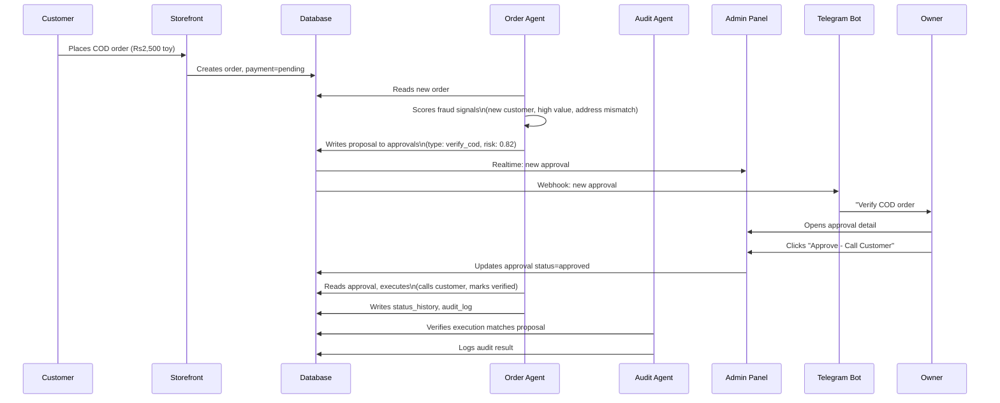
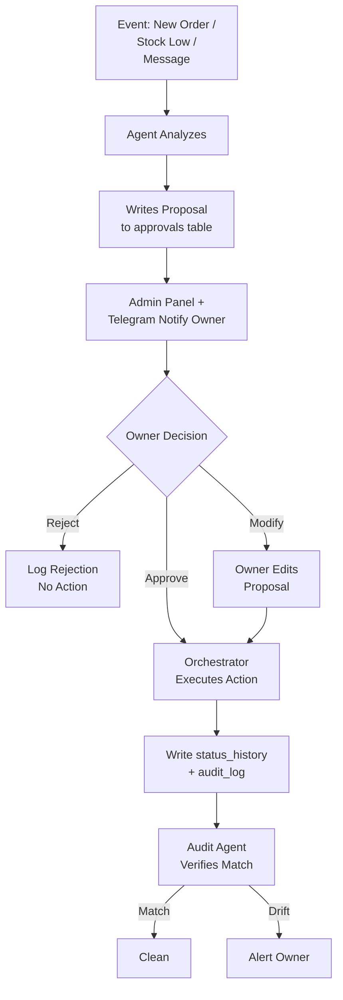
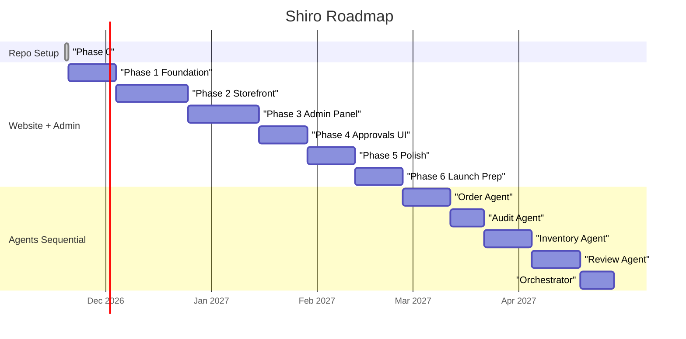

<div align="center">

# 🟣 Shiro

**An AI operations team for small online sellers. Agents suggest, you decide.**


> **Honest Status**: This project is in **Planning / Pre-alpha**. No code is implemented yet. All diagrams, features, and architecture represent *planned* work. See [ROADMAP](docs/ROADMAP.md) for phases.

---

</div>

## Table of Contents

1. [The Problem](#the-problem)
2. [The Solution](#the-solution)
3. [Who It's For](#who-its-for)
4. [How It Works](#how-it-works)
5. [Agent Team](#agent-team)
6. [Example Flow: Suspicious COD Order](#example-flow-suspicious-cod-order)
7. [Human-in-the-Loop Approval Flow](#human-in-the-loop-approval-flow)
8. [Feature List](#feature-list)
9. [Planned Tech Stack](#planned-tech-stack)
10. [Roadmap](#roadmap)
11. [Repository Structure](#repository-structure)
12. [What Shiro Is Not](#what-shiro-is-not)
13. [How We're Different](#how-were-different)
14. [Getting Started](#getting-started)
15. [Team](#team)
16. [Contributing, Security, License](#contributing-security-license)

---

## The Problem

Small online sellers in India — home-based, selling through Instagram, WhatsApp, basic websites — spend **hours every day** on manual operations:

- 📦 Tracking 150+ orders/month across statuses
- 📊 Checking stock across variants manually
- 💬 Replying to repetitive customer messages
- 🚫 Fighting fraudulent COD orders & RTO abuse (fake orders, refused deliveries)

Existing AI and operations tools target **large retailers** with big budgets. Small sellers need **affordable help** while staying **in control** of every decision.

---

## The Solution

Shiro is an **e-commerce platform with a built-in AI agent team** for small Indian sellers. Three layers work together:

| Layer | Purpose |
|-------|---------|
| **Storefront** | Customer-facing toy store (swappable theme per seller) |
| **Admin Panel** | Owner's control room — orders, stock, approvals, audit log |
| **Agent Team** | AI agents that handle daily ops, **human approval required** |

### Core Loop

```
Agent suggests -> Human decides -> Audit Agent records
```

Every important action goes through the owner. The **Audit Agent** watches all agents and creates an immutable trail.

---

## Who It's For

| Profile | Example |
|---------|---------|
| **Primary** | Home-based toy seller, ~150 orders/month, Instagram primary channel |
| **Secondary** | Any small Indian seller (50-500 orders/month) needing ops help |
| **Pain points** | COD fraud, RTO, manual tracking, multilingual replies (Hindi/Gujarati), low budget |

---

## How It Works

### Three-Layer Architecture



### Data Flow

1. **Customer places order** -> Storefront writes to `orders`, `order_items`, `payments`
2. **Order Agent** reads new order -> evaluates fraud signals -> writes proposal to `approvals`
3. **Admin Panel** shows pending approvals -> Owner approves/rejects -> writes decision
4. **Orchestrator** executes approved action -> writes to `status_history`, `audit_log`
5. **Audit Agent** continuously verifies all writes match proposals -> flags discrepancies
6. **Telegram Bot** sends real-time approval requests to owner

---

## Agent Team

| Agent | Job | Needs Human Approval For |
|-------|-----|--------------------------|
| **Orchestrator** | Routes tasks, coordinates agents, ensures audit trail | - (coordinates only) |
| **Order Agent** | Processes orders, flags fraud, manages status | COD verification, address correction, cancellation, refund, ship confirm |
| **Inventory Agent** | Tracks stock, predicts restock, manages variants | Purchase orders, price changes, discontinuing SKUs |
| **Review & Support Agent** | Drafts replies, manages reviews, handles FAQs | Sending replies, public review responses, policy exceptions |
| **Audit Agent** | Watches all agents, verifies actions match proposals, flags drift | - (read-only watcher) |

### Agent Team Diagram



---

## Example Flow: Suspicious COD Order



---

## Human-in-the-Loop Approval Flow



---

## Feature List

### Storefront (Customer-Facing)

| Status | Feature |
|--------|---------|
| **MVP** | Home page, product listing, product detail, cart, checkout (COD/UPI), order confirmation, public tracking, mobile-first, violet/off-white theme |
| **Later** | Wishlist, guest checkout, coupons, gift wrap, reviews, PWA, multi-language UI, WhatsApp fallback, SEO structured data |

### Admin Panel (Owner-Facing)

| Status | Feature |
|--------|---------|
| **MVP** | Owner login, dashboard, orders list/detail, order actions (confirm/ship/cancel/refund), products CRUD, stock view, low stock alerts, customers list, approvals queue, approval detail, settings, audit log viewer |
| **Later** | Bulk actions, returns/RMA, GST invoices, sales reports, customer segments, supplier management, multi-user roles, webhooks, dark mode, keyboard shortcuts, CSV import/export |

### Agents (Post Phase 6)

| Agent | MVP Capability |
|-------|----------------|
| Order Agent | Flag suspicious COD, propose verify/cancel |
| Audit Agent | Log all proposals/decisions, flag drift |
| Inventory Agent | Low stock alert, propose PO |
| Review & Support Agent | Draft replies (Hindi/Gujarati/English), FAQ match |
| Orchestrator | Route tasks, enforce approvals |

See [FEATURES.md](docs/FEATURES.md) for full lists.

---

## Planned Tech Stack

| Layer | Tool | Why |
|-------|------|-----|
| Web Framework | Next.js 14+ (App Router) | React, ISR, Server Actions, great DX |
| Language | TypeScript 5+ (strict) | Type safety across stack |
| Styling | Tailwind CSS 3+ | Design tokens, dark mode ready, small bundle |
| Database | Supabase (PostgreSQL) | Managed Postgres, Auth, Realtime, RLS |
| Auth | Supabase Auth | Email/phone OTP, magic links, Row Level Security |
| Agents | Python 3.11+ + LangGraph | Purpose-built for agent workflows, stateful |
| Approvals | Telegram Bot API | Universal in India, buttons, deep links |
| Hosting (Web) | Vercel | Next.js native, preview deploys, edge |
| Hosting (Agents) | Render | Background workers, simple Python deploys |
| CI/CD | GitHub Actions | Lint, typecheck, test, preview |

---

## Roadmap

### Phases 0-6: Website + Admin (Foundation -> Launch)

| Phase | Focus | Duration |
|-------|-------|----------|
| **0** | Repository Setup | Done |
| **1** | Foundation (Next.js, Supabase, Schema, CI) | 2 weeks |
| **2** | Storefront (Customer UI) | 3 weeks |
| **3** | Admin Panel (Owner UI) | 3 weeks |
| **4** | Approvals UI + Telegram Bot | 2 weeks |
| **5** | Polish, Tests, Monitoring | 2 weeks |
| **6** | Launch Prep (Demo seller, load test, security) | 2 weeks |

### Agents (Sequential, Post Phase 6)

| Order | Agent | Est. Time |
|-------|-------|-----------|
| 1 | Order Agent | 2 weeks |
| 2 | Audit Agent | 1.5 weeks |
| 3 | Inventory Agent | 2 weeks |
| 4 | Review & Support Agent | 2 weeks |
| 5 | Orchestrator | 1.5 weeks |

### Progress

```
Phase 0: Repository Setup          [##########] 100% Done
Phase 1: Foundation                [          ]   0%
Phase 2: Storefront                [          ]   0%
Phase 3: Admin Panel               [          ]   0%
Phase 4: Approvals UI              [          ]   0%
Phase 5: Polish & Harden           [          ]   0%
Phase 6: Launch Prep               [          ]   0%
------------------------------------------------------------
Order Agent                        [          ]   0%
Audit Agent                        [          ]   0%
Inventory Agent                    [          ]   0%
Review & Support Agent             [          ]   0%
Orchestrator                       [          ]   0%
```

### Mermaid Gantt



See [ROADMAP.md](docs/ROADMAP.md) for detailed checkboxes.

---

## Repository Structure

```
Shiro/
├── apps/web/           # Next.js storefront + admin (Planned)
├── services/agents/    # Python agent service (Planned)
├── database/           # SQL migrations, seeds (Planned)
├── scripts/            # Utility scripts (Planned)
├── docs/               # All documentation
│   ├── OVERVIEW.md
│   ├── ARCHITECTURE.md
│   ├── AGENTS.md
│   ├── DATA_MODEL.md
│   ├── ROADMAP.md
│   ├── DECISIONS.md
│   ├── FEATURES.md
│   └── assets/         # Logos, banners (Placeholder)
├── .github/            # Issue templates, PR template, workflows
├── CONTRIBUTING.md
├── SECURITY.md
├── CODE_OF_CONDUCT.md
├── AGENTS.md           # Rules for AI coding tools
├── .gitignore
├── .env.example
├── LICENSE             # TBD - undecided
└── README.md           # This file
```

---

## What Shiro Is Not

- Not a fully autonomous "AI runs your business" system — human approval required
- Not a replacement for your storefront — includes one, but theme is swappable
- Not a generic chatbot — agents are specialized, auditable, tied to your data
- Not the first multi-agent ops system — pattern exists; our angle is **small-seller, India-specific, human-approved, auditable, low-cost**
- Not built yet — **Planning / Pre-alpha**

---

## How We're Different

| Aspect | Typical Tools | Shiro |
|--------|---------------|-------|
| Target | Large retailers | Small Indian sellers (50-500 orders/mo) |
| Control | Often autonomous | **Human approval for every important action** |
| Audit | Rare | **Audit Agent watches all agents, immutable log** |
| COD/RTO | Generic fraud | **India-specific: address mismatch, new customer, high-value COD** |
| Language | English only | **Hindi + Gujarati (Devanagari + Latin script)** |
| Cost | 10k+/mo | **Target 500-2000/mo** |
| Data | Locked in | **Your Supabase project, your data** |

---

## Getting Started

> **Not available yet.** Code is coming in **Phase 1** (Foundation).

When ready:
```bash
git clone https://github.com/RishiSakhija/Shiro
cd Shiro

# Web app (Phase 1+)
cd apps/web
pnpm install
pnpm dev

# Agent service (Post Phase 6)
cd ../services/agents
python -m venv .venv
source .venv/bin/activate
pip install -r requirements.txt
```

See [ROADMAP.md](docs/ROADMAP.md) for current phase and [CONTRIBUTING.md](CONTRIBUTING.md) for contribution guidelines.

---

## Team

| Role | Placeholder |
|------|-------------|
| Product Lead | **[Your Name]** |
| Tech Lead | **[Your Name]** |

*Add contributors as they join.*

---

## Contributing, Security, License

- **Contributing**: See [CONTRIBUTING.md](CONTRIBUTING.md) — no direct pushes to `main`, PRs only, small tasks, human review required
- **Security**: See [SECURITY.md](SECURITY.md) — report vulnerabilities privately, never commit secrets
- **Code of Conduct**: See [CODE_OF_CONDUCT.md](CODE_OF_CONDUCT.md)
- **License**: **TBD** — licensing undecided, will be set before any public release

---

<div align="center">

**Built in the open. For small sellers who deserve better tools.**

*Shiro (白) — white, clean, honest.*

</div>