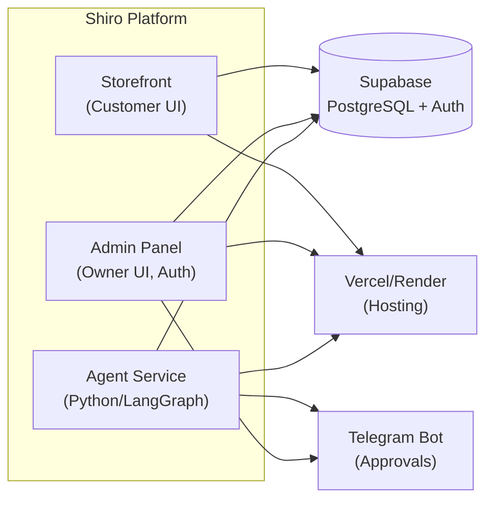

# Architecture

## Three Layers

```
┌─────────────────────────────────────────────────────────────┐
│                      SHIRO PLATFORM                          │
├──────────────────┬──────────────────────┬────────────────────┤
│   STOREFRONT     │    ADMIN PANEL       │    AGENT SERVICE   │
│  (Customer UI)   │   (Owner UI, Auth)   │  (Python/LangGraph)│
└────────┬─────────┴──────────┬───────────┴─────────┬──────────┘
         │                    │                     │
         └────────────────────┼─────────────────────┘
                              ▼
         ┌────────────────────────────────────────┐
         │         SUPABASE (POSTGRES + AUTH)     │
         │  ┌──────────┐  ┌──────────┐  ┌───────┐ │
         │  │  Tables  │  │  Auth    │  │ Realtime│ │
         │  └──────────┘  └──────────┘  └───────┘ │
         └────────────────────┬───────────────────┘
                              │
                    ┌─────────┴─────────┐
                    ▼                   ▼
             ┌─────────────┐     ┌──────────────┐
             │  TELEGRAM   │     │   VERCEL /   │
             │    BOT      │     │   RENDER     │
             │ (Approvals) │     │  (Hosting)   │
             └─────────────┘     └──────────────┘
```

## Mermaid: System Architecture



## Data Flow

1. **Customer places order** -> Storefront writes to `orders`, `order_items`, `payments` tables
2. **Order Agent** (polling or trigger) reads new order -> evaluates fraud signals -> writes proposal to `approvals`
3. **Admin Panel** shows pending approvals -> Owner approves/rejects -> writes decision to `approvals`
4. **Orchestrator** executes approved action -> writes to `status_history`, `audit_log`
5. **Audit Agent** continuously verifies all writes match proposals -> flags discrepancies
6. **Telegram Bot** sends real-time approval requests to owner

## Communication Rules

| From | To | Via |
|------|-----|-----|
| Storefront | Database | Supabase client (RLS policies) |
| Admin Panel | Database | Supabase client (RLS policies) |
| Agent Service | Database | Supabase service role (server-only) |
| Agent Service | Telegram | Bot API (server-only) |
| Admin Panel | Telegram | Deep links / Web App |
| All | Audit Log | Database trigger + Agent Service |

## Security Boundaries

- **Storefront**: Public read, authenticated write (customer)
- **Admin Panel**: Owner-only (Supabase Auth + RLS)
- **Agent Service**: Service role key only (never in frontend)
- **Telegram Bot**: Owner's chat ID only (configured in env)