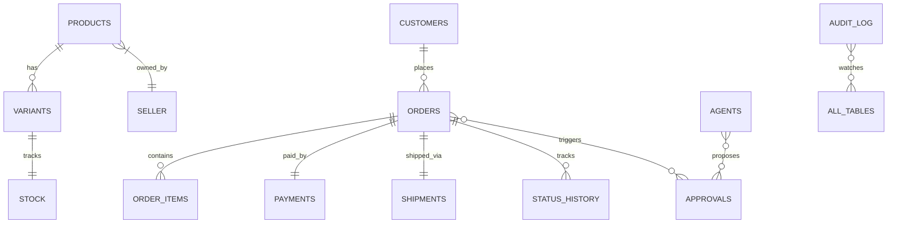

# Data Model (Draft)

> **Status**: Draft — not implemented. Schema will be created in Phase 1.

## Core Tables

### products
| Column | Type | Notes |
|--------|------|-------|
| id | uuid | PK |
| seller_id | uuid | FK → auth.users |
| name | text | |
| description | text | |
| base_price | integer | Paise |
| category | text | e.g., "toys" |
| theme_config | jsonb | Violet/off-white overrides |
| status | text | active, draft, archived |
| created_at | timestamptz | |
| updated_at | timestamptz | |

### variants
| Column | Type | Notes |
|--------|------|-------|
| id | uuid | PK |
| product_id | uuid | FK → products |
| sku | text | Unique |
| attributes | jsonb | e.g., {"color": "red", "size": "M"} |
| price_override | integer | Optional, paise |
| images | text[] | URLs |
| status | text | active, inactive |

### stock
| Column | Type | Notes |
|--------|------|-------|
| id | uuid | PK |
| variant_id | uuid | FK → variants |
| quantity | integer | Current available |
| reserved | integer | Allocated to pending orders |
| reorder_point | integer | Alert threshold |
| reorder_qty | integer | Suggested restock qty |
| updated_at | timestamptz | |

### customers
| Column | Type | Notes |
|--------|------|-------|
| id | uuid | PK |
| phone | text | Primary (Indian format) |
| email | text | Optional |
| name | text | |
| address_json | jsonb | Structured address |
| tags | text[] | e.g., "repeat", "high_risk" |
| created_at | timestamptz | |

### orders
| Column | Type | Notes |
|--------|------|-------|
| id | uuid | PK |
| customer_id | uuid | FK → customers |
| order_number | text | Human-readable |
| status | text | pending, confirmed, shipped, delivered, cancelled, returned |
| payment_method | text | cod, prepaid, upi |
| payment_status | text | pending, paid, failed, refunded |
| subtotal | integer | Paise |
| shipping_fee | integer | Paise |
| discount | integer | Paise |
| total | integer | Paise |
| shipping_address | jsonb | Snapshot at order time |
| notes | text | Internal notes |
| created_at | timestamptz | |
| updated_at | timestamptz | |

### order_items
| Column | Type | Notes |
|--------|------|-------|
| id | uuid | PK |
| order_id | uuid | FK → orders |
| variant_id | uuid | FK → variants |
| quantity | integer | |
| unit_price | integer | Paise (snapshot) |
| total_price | integer | Paise |

### payments
| Column | Type | Notes |
|--------|------|-------|
| id | uuid | PK |
| order_id | uuid | FK → orders |
| method | text | cod, upi, card, wallet |
| amount | integer | Paise |
| status | text | pending, success, failed, refunded |
| gateway_ref | text | Razorpay/PhonePe ref |
| paid_at | timestamptz | Nullable |

### shipments
| Column | Type | Notes |
|--------|------|-------|
| id | uuid | PK |
| order_id | uuid | FK → orders |
| carrier | text | Delhivery, BlueDart, etc. |
| tracking_number | text | |
| tracking_url | text | |
| status | text | created, picked_up, in_transit, delivered, returned |
| shipped_at | timestamptz | |
| delivered_at | timestamptz | |

### status_history
| Column | Type | Notes |
|--------|------|-------|
| id | uuid | PK |
| order_id | uuid | FK → orders |
| from_status | text | |
| to_status | text | |
| changed_by | text | "agent:order", "admin:owner", "customer" |
| reason | text | |
| created_at | timestamptz | |

### audit_log
| Column | Type | Notes |
|--------|------|-------|
| id | uuid | PK |
| entity_type | text | orders, approvals, stock, etc. |
| entity_id | uuid | |
| action | text | create, update, approve, reject, execute |
| agent_name | text | order_agent, inventory_agent, etc. |
| proposal_json | jsonb | What was proposed |
| decision_json | jsonb | What was decided |
| executed_json | jsonb | What actually happened |
| created_at | timestamptz | |

### approvals
| Column | Type | Notes |
|--------|------|-------|
| id | uuid | PK |
| agent_name | text | Which agent proposed |
| proposal_type | text | verify_cod, cancel_order, create_po, send_reply, etc. |
| payload_json | jsonb | Full proposal details |
| status | text | pending, approved, rejected, expired |
| decided_by | uuid | FK → auth.users (owner) |
| decided_at | timestamptz | |
| expires_at | timestamptz | Auto-expire after 24h |
| created_at | timestamptz | |

## Mermaid ER Diagram

## RLS Policy Sketch (Planned)

- `products`, `variants`, `stock`: Public read (active), seller write
- `customers`: Owner read/write only
- `orders`, `order_items`: Customer read own, owner read/write
- `payments`, `shipments`: Owner read/write
- `status_history`, `audit_log`, `approvals`: Owner read only (append via service role)